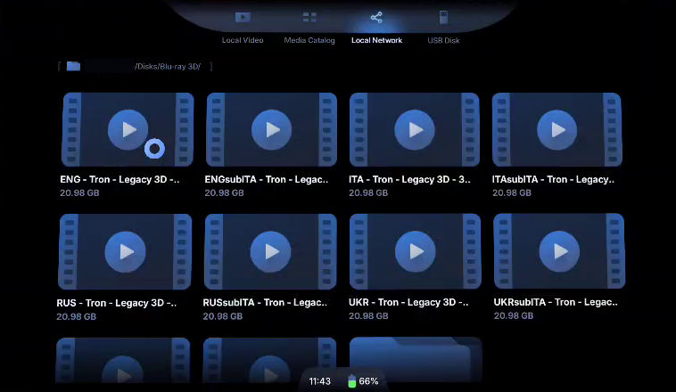

🇬🇧 English | [🇮🇹 Italiano](README.it.md)

# Blu-rays and DVDs on every screen at home, 3D included, from Linux
#### _Put a disc in your Linux PC's drive and watch it on any device at home: TV, tablet, phone, XR glasses. The PC reads, decrypts and decodes the disc on the fly and serves it over the LAN as an ordinary video file. 3D Blu-rays become real side-by-side 3D for XR glasses (VITURE & co.). No rip, no conversion, no disk space._

***Note:*** _Any player able to open videos from a network share (SMB), or browse a DLNA/UPnP media server instead ([docs/OPTIONS.md](docs/OPTIONS.md#dlnaupnp-instead-of-samba)), should work; for 3D it must also show side-by-side video. Devices, players and discs tested so far, with a guide for each: [**docs/TESTED.md**](docs/TESTED.md)._



---

## The problem

A 3D Blu-ray does not contain two videos side by side. It stores the 3D as **MVC** (H.264 _Multiview Video Coding_): a normal 2D video for the left eye plus a "dependent view" with the differences for the right eye.

- XR glasses (and almost every 3D video player) want **SBS**, _side-by-side_: both eyes in one frame.
- Practically **nothing decodes MVC** outside dedicated Blu-ray players: Android and its players cannot, and FFmpeg silently drops the dependent view (you get 2D).
- The usual answer is to **rip and convert** every movie to SBS: hours of work and 10-20 GB for each movie.

## The idea

The PC reads the disc and decodes the MVC **while you watch**, and serves the result to the glasses as if it were an ordinary SBS file.

```
3D Blu-ray in the drive (or an ISO / BDMV folder / MKV rip)
        │  libbluray + libaacs: read and decrypt on the fly
        ▼
   base + dependent view ─► edge264 (MVC → SBS 3840×1080) ─► encoder (NVENC or x264) + audio
        │
        ▼
   "ITA - movie - 3D SBS.ts"  a virtual file in an SMB share (it does not exist on disk)
        │   Wi-Fi
        ▼
   Glasses / headset: player ► network share ► Disks ► movie   → 3D, pause, seek
```

- **Insert the disc, the movie appears.** About 15 seconds after closing the tray the file shows up in the share, named after the disc; eject the disc and it goes away.
- **3D Blu-rays, 2D Blu-rays and DVDs.** Same flow for all: 3D discs go in the `Blu-ray 3D/` folder, 2D Blu-rays in `Blu-ray/`, DVDs in `DVD/`.
- **TV series.** A Blu-ray with several episodes names each one `S01E05 - Show.ts`, in play-all order, with the season read from the disc's own name ([details](docs/OPTIONS.md#tv-series)); `--lookup` also names each episode with its real title, found online on [TheDiscDB](https://thediscdb.com) ([details](docs/OPTIONS.md#online-episode-lookup)).
- **Any device at home.** A TV, tablet or phone with a player that opens network shares plays the Blu-rays and DVDs; the 3D files need a player that shows side-by-side 3D (XR glasses, VR headsets). Several devices can watch at once, even the same disc in two languages.
- **Nothing is written to disk.** The `.ts` file shows a size of ~22 GB but takes no space: every piece is produced when the player reads it.
- **Seeking works.** The file has a constant bitrate, so every byte matches a precise second of the movie. When the player jumps, the PC restarts reading the disc from there (a few seconds: the optical drive has to move).
- **Players see a normal file.** No special app on the player: its own interface, pause, seek, and 3D detection — over the SMB share by default, or a DLNA/UPnP media server instead ([`--share dlna`](docs/OPTIONS.md#dlnaupnp-instead-of-samba), for players that browse one rather than opening a share).

All the procedures described here are a balanced compromise between "manual" and guided processes. This is one of the possible ways to do it.

## Requirements

#### Hardware
- **A Blu-ray drive** in the Linux PC (internal or USB), which reads DVDs too. Its name is usually `/dev/sr0`; with more than one drive, `lsblk -d -o NAME,MODEL | grep sr` tells which is which.
- **A Linux PC** on the same network as the glasses. Decoding MVC is CPU work: a recent multi-core desktop CPU is plenty (on the test PC decoding runs at ~9× real time). Low-power CPUs have not been tested.
- **Optional: an NVIDIA GPU** to encode with NVENC. Without it the video is encoded by the CPU with x264 (on the same CPU still ~6× real time).
- **XR glasses + a player** that opens videos from an SMB network share and plays SBS 3D ([tested ones](docs/TESTED.md)).
- **RAM**: about 0.5 GB free while a movie plays. Nothing is written to disk: the pipeline prepares up to ~256 MB ahead of the player in memory and keeps ~190 MB behind for short jumps back, plus 16 MB (start and end) per file opened.
- **A good Wi-Fi connection** (5 GHz recommended): 15 Mbit/s for 2D, 24 Mbit/s for 3D, less with the `Light/` copies (see [Network and quality](docs/OPTIONS.md#network-and-quality)).

#### Decryption: bring your own keys
Commercial Blu-rays are encrypted (AACS, some also BD+). The project **does not provide or download any key**; it uses what you have, in this order:
1. **libaacs + `KEYDB.cfg`**: fully open source. Put a key database in `~/.config/aacs/KEYDB.cfg` (for Docker: the folder you set as `AACS_DIR`).
2. **MakeMKV**, if installed and registered: its `libmmbd` library decrypts AACS in place of libaacs.
3. Unencrypted **ISO / BDMV folders** need no keys.

**BD+ discs** (a minority, released up to about 2017) are decrypted by **libaacs + libbdplus**, open source. libbdplus needs two things you provide, in `~/.config/bdplus/` (for Docker: the folder you set as `BDPLUS_DIR`): `vm0/`, its configuration, and `convtab/`, the precomputed conversion tables of the discs (a community archive covers practically every BD+ disc). Where to find them: the [ArchWiki Blu-ray page](https://wiki.archlinux.org/title/Blu-ray) and the thread it links ([archived copy](https://web.archive.org/web/20260910011411/https://forum.doom9.org/showthread.php?t=176924)). A BD+ disc without its table is skipped, and the log says so. MakeMKV is not used for BD+: it opens these discs, but after every jump in the movie the picture breaks up.

DVDs (CSS) are decrypted by **libdvdcss**, which you install yourself: on Debian/Ubuntu `sudo apt install libdvd-pkg && sudo dpkg-reconfigure libdvd-pkg` (Debian: `contrib` section). It is not in the Docker image; `docker-compose.yml` has a commented line to use the host's.

> ⚖️ In many countries (Italy and most of the EU included) circumventing copy protection is not allowed, not even for a private copy. Check the law where you live.

#### Software on the PC
- **Docker** (path A) _or_ a **Debian/Ubuntu** system (path B). Everything else is installed for you:
  - [edge264-mvc](https://github.com/jens-duttke/edge264-mvc): the only open-source decoder of the MVC dependent view;
  - libbluray, libaacs, libbdplus (Blu-ray), libdvdread (DVD), FFmpeg, Samba (the network share), FUSE + pyfuse3 (the virtual file; Samba and FUSE are not needed with `--share dlna`).

---

## Step 1 — Install: choose your path

| | **A. Docker** | **B. Release package** | **C. Native script** |
|---|---|---|---|
| For | anyone who already uses Docker | Debian / Ubuntu | a working clone |
| Touches the system | no: Samba, FUSE and libraries live in the container | yes: packages, `/opt`, `smb.conf`, `fuse.conf` | yes: packages, `/opt`, `smb.conf`, `fuse.conf` |
| Decryption | libaacs + your KEYDB (MakeMKV is not in the image) | libaacs + KEYDB, or MakeMKV if installed | libaacs + KEYDB, or MakeMKV if installed |
| NVIDIA encoding | needs the NVIDIA Container Toolkit | works out of the box | works out of the box |
| Samba already installed on the PC | conflicts on port 445: stop it first | the share is added next to yours | the share is added next to yours |

For Docker or a clone-based native install, get the project first:
```console
git clone https://github.com/suppressio/bluray3d-xr-glasses-linux.git
cd bluray3d-xr-glasses-linux
```

### Path A — Docker

- [ ] Create your settings:
```console
cp .env.example .env
```
- [ ] Edit `.env`:
  - `DRIVE=/dev/sr0` to watch the Blu-ray drive, and in `docker-compose.yml` uncomment the `- /dev/sr0` line under `devices`;
  - `AACS_DIR` = the folder containing your `KEYDB.cfg`;
  - `BDPLUS_DIR` = the folder with `vm0/` and `convtab/` for BD+ discs (see [Decryption](#decryption-bring-your-own-keys); leave it as it is if you have none);
  - `MOVIES_DIR` = a folder with ISO, BDMV folders or MKV rips (can be empty if you only use the drive);
  - `AUDIO_LANG` and `SUBS` = the audio and subtitle languages you want, e.g. `ita,eng` (the rest: [docs/OPTIONS.md](docs/OPTIONS.md)).
- [ ] Build and start (the first build takes a few minutes: it compiles edge264 for your CPU):
```console
docker compose up -d --build
```
- [ ] Insert a disc (3D or 2D Blu-ray, DVD) and check the log:
```console
docker compose logs -f
```
```
watching /dev/sr0: insert a disc
/dev/sr0: disc inserted, opening it
+ Blu-ray 3D/ITA - Tron - Legacy 3D - 3D SBS.ts  (125 min, 24.0 Mbit/s, audio 0x1102 ita dts)
```

Stop it with `docker compose down`. Updating and uninstalling: [below](#updating-and-uninstalling).

##### NVIDIA GPU (optional)
Install the [NVIDIA Container Toolkit](https://docs.nvidia.com/datacenter/cloud-native/container-toolkit/latest/install-guide.html), then start with both compose files:
```console
docker compose -f docker-compose.yml -f docker-compose.nvidia.yml up -d --build
```
The log should now say `video encoder: nvenc`.
> ⚠️ This variant is not tested yet (my PC has no Container Toolkit). NVENC is tested with the native path.

##### 💩 happens: port 445 already in use
If the PC already runs Samba, the container cannot take port 445. Players on phones and glasses usually only speak to port 445, so stop the host Samba while you watch (`sudo systemctl stop smbd`) or use path B, which adds a share to your existing Samba.

### Path B — Release package (Debian / Ubuntu)

- [ ] Download the `.deb` for your system from [Releases](https://github.com/suppressio/bluray3d-xr-glasses-linux/releases), then install it:
```console
sudo apt install ./bluray3d-xr_<version>_amd64.deb
```
- [ ] Add your user to the package's group so you can read the mounted files; log out and back in for the change to take effect:
```console
sudo adduser "$USER" bluray3d-xr
```

- [ ] Your user must be able to read the drive (on Debian/Ubuntu: the `cdrom` group, usually already set for desktop users).
- [ ] If `ufw` is active, allow the share through your firewall, e.g.:
```console
sudo ufw allow from 192.168.1.0/24 to any port 445 proto tcp
```
- [ ] Start it when you want to watch something:
```console
bluray3d-xr --audio-lang ita,eng --subs ita,eng /dev/sr0
```
When a disc goes in, its files appear; every `pipeline from` line is the player starting or jumping:
```
11:23:59 bluray3d-xr v1.0.0
11:24:00 video encoder: nvenc
11:24:00 watching /dev/sr0: insert a disc
11:24:00 mounted on /srv/bd3d — Ctrl+C to unmount
11:24:00 /dev/sr0: disc inserted, opening it
11:24:00 + Blu-ray 3D/ITA - Tron - Legacy 3D - 3D SBS.ts  (125 min, 24.0 Mbit/s, audio 0x1102 ita dts, forced subtitles ita)
11:24:00 + Blu-ray 3D/ITAsubITA - Tron - Legacy 3D - 3D SBS.ts  (125 min, 24.0 Mbit/s, audio 0x1102 ita dts, subtitles ita)
11:24:00 + Blu-ray 3D/ENG - Tron - Legacy 3D - 3D SBS.ts  (125 min, 24.0 Mbit/s, audio 0x1100 eng dts-hd ma, forced subtitles eng)
...
11:30:24 Blu-ray 3D/Light/ITA - Tron - Legacy 3D - 3D SBS.ts: pipeline from 0.0s (requested 0.0s, offset 0)
11:30:35 Blu-ray 3D/Light/ITA - Tron - Legacy 3D - 3D SBS.ts: pipeline from 1634.8s (requested 1635.3s, offset 2043548532)
```
Stop it with `Ctrl+C`. Updating and uninstalling: [below](#updating-and-uninstalling).

### Path C — Native script (from a clone)

If you are using a working clone instead of the release package, run [`scripts/install.sh`](scripts/install.sh) as your normal user. It installs the packages, compiles edge264, installs the command and adds the read-only guest share `[Disks]` to Samba. The script supports Debian/Ubuntu; it remains available for clone-based installs.

`scripts/install.sh --share dlna` skips Samba/FUSE entirely and sets up [DLNA/UPnP](docs/OPTIONS.md#dlnaupnp-instead-of-samba) instead; `--share both` installs both (default: `samba`).

### Updating and uninstalling

**Updating**, when a new version is out (see [Releases](https://github.com/suppressio/bluray3d-xr-glasses-linux/releases)); `bluray3d-xr --version` tells which one you have:
- release package: download the new `.deb` and install it with `sudo apt install ./bluray3d-xr_<version>_amd64.deb`;
- native: `./scripts/update.sh` in the project folder. It downloads the latest version and copies the program to `/opt/bluray3d-xr`; it runs the whole `install.sh` again only when needed (edge264 changed, or nothing is installed). It ends with "Updated from vX to vY" and the list of changes. If the program is running, stop it and start it again.
- Docker: `git pull && docker compose up -d --build`.

**Uninstalling**:
- release package: `sudo apt remove bluray3d-xr` removes the share and `/srv/bd3d`; `sudo apt purge bluray3d-xr` also removes the `bluray3d-xr` group. The `user_allow_other` line stays in `/etc/fuse.conf`.
- native: `./scripts/uninstall.sh`. It unmounts `/srv/bd3d` and removes it, removes the `[Disks]` share from `smb.conf` (only the block it added: your own shares stay), `/opt/bluray3d-xr` and the `bluray3d-xr` command. The apt packages (FFmpeg, Samba, libbluray...) and the `user_allow_other` line in `/etc/fuse.conf` stay, since other software may use them: remove them with apt if nothing needs them.
- Docker: `docker compose down --rmi all` stops the container and deletes its image.

Then delete the project folder.

---

## Step 2 — Watch it on the glasses

- [ ] Insert the disc in the PC and wait about 15 seconds.
- [ ] On the glasses, headset or TV, open the network share of the PC: many players find it by themselves under "local network", otherwise add its IP address (`hostname -I` on the PC tells you), guest / anonymous access.
- [ ] Open the **Disks** folder (go back and in again if it looks empty). 3D discs are in `Blu-ray 3D/` as `ITA - <movie> - 3D SBS.ts`, normal ones in `Blu-ray/` as `ITA - <movie>.ts`: one file per audio language, plus versions with subtitles (`ITAsubENG - ...`: Italian audio, English subtitles). `Light/` has the same movies at a lower bitrate, for weak Wi-Fi.

```
Disks/
├── Blu-ray 3D/
│   ├── ITA - Tron - Legacy 3D - 3D SBS.ts
│   ├── ITAsubENG - Tron - Legacy 3D - 3D SBS.ts
│   ├── ENG - Tron - Legacy 3D - 3D SBS.ts
│   └── Light/ ...
├── Blu-ray/
│   ├── ITA - Ready Player One.ts
│   └── Light/ ...
└── DVD/
    ├── ITA - Back To The Future.ts
    └── Light/ ...
```
- [ ] Open it. 3D files are full side by side (3840×1080, a whole 1920×1080 picture per eye): if the player does not switch to 3D by itself, choose its side-by-side (SBS) 3D mode. 🎉

The first opening and every jump with the seek bar take a few seconds: that is the drive moving to the new point.

Step by step for the VITURE 3D Player, the PICO 4's own player and VLC, and what each one can and cannot do: [**docs/TESTED.md**](docs/TESTED.md).

---

## Languages, subtitles, quality

The defaults offer everything on the disc. Most people want only their languages:
```console
bluray3d-xr --audio-lang ita,eng --subs ita,eng /dev/sr0
```
(Docker: `AUDIO_LANG=ita,eng` and `SUBS=ita,eng` in `.env`.) Every other option, and ISO files, BDMV/VIDEO_TS folders or MKV rips instead of a drive: [**docs/OPTIONS.md**](docs/OPTIONS.md).

---

## Troubleshooting

Something does not work? See [docs/TROUBLESHOOTING.md](docs/TROUBLESHOOTING.md), which also says how to report a problem.

---

## Development

How the program reads, decodes and serves a disc: [docs/ARCHITECTURE.md](docs/ARCHITECTURE.md). Running it from a clone, where things are in the code, the tests and the logs: [docs/DEVELOPMENT.md](docs/DEVELOPMENT.md).

---

## Limits

- The last ~2.7 seconds of every movie (after the end credits) are black: the tail of the file is synthetic.
- Tested on a handful of discs ([docs/TESTED.md](docs/TESTED.md#discs)), AACS only except one BD+ disc. NTSC DVDs are untested.
- Subtitles from the disc are drawn into the picture (one version per language), not selectable in the player; the 3D depth is fixed, not taken from the disc. Audio is converted to AAC stereo.

## Windows?

This project is Linux only. On Windows you can look at [**SyLC**](https://github.com/5ymph0en1x/SyLC), an open-source player that plays 3D Blu-ray MVC directly (MKV, ISO, BDMV) and can output SBS. I have not tried it.

## License

[MIT](LICENSE). It covers this project's code only: edge264, libbluray, libaacs, FFmpeg, Samba and the other tools it uses keep their own licenses, and are downloaded or installed from their sources, not shipped here.

## Credits and references

- [edge264-mvc](https://github.com/jens-duttke/edge264-mvc) (BSD), fork of [edge264](https://github.com/tvlabs/edge264): the MVC decoder that makes all this possible;
- [libbluray / libaacs](https://www.videolan.org/developers/libbluray.html), [FFmpeg](https://ffmpeg.org/), [Samba](https://www.samba.org/), [pyfuse3](https://github.com/libfuse/pyfuse3), [MakeMKV](https://www.makemkv.com/);
- [Play 3D Blu-ray in SBS directly from the disc…](https://cybereality.com/play-3d-blu-ray-in-sbs-directly-from-the-disc-for-playback-on-3d-monitors-xr-glasses-and-vr-headsets-using-free-and-open-source-tools/) (cybereality): a Windows approach (LAV Filters + madVR).
